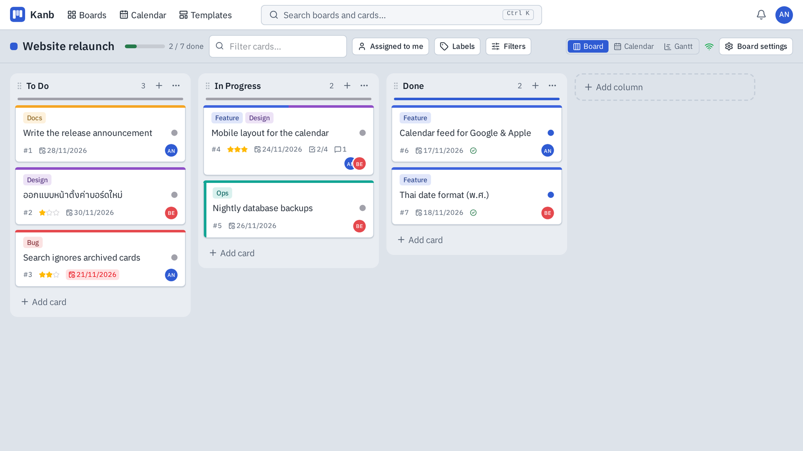
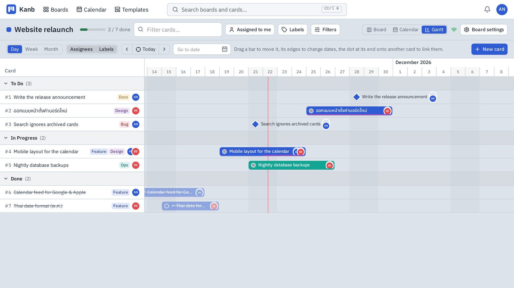
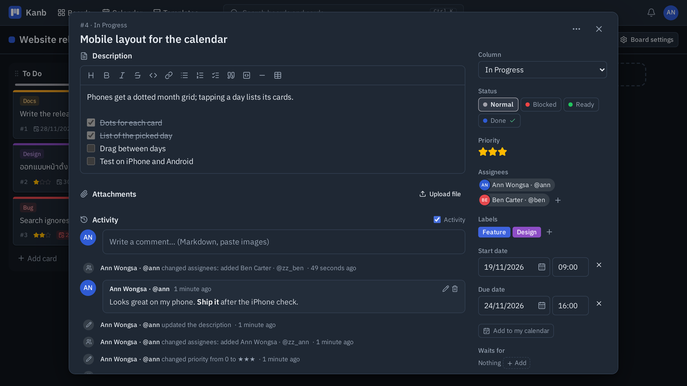
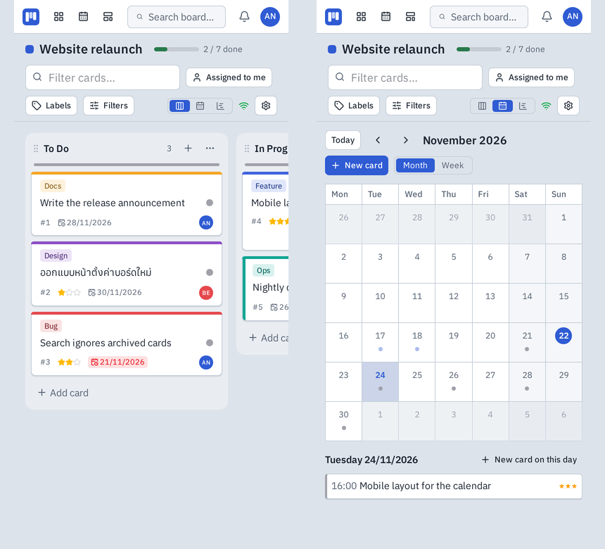

# Kanb

[](https://github.com/Jadepat-C/kanb/actions/workflows/ci.yml)
[](https://github.com/Jadepat-C/kanb/pkgs/container/kanb)
[](LICENSE)

Kanb is a self-hosted Kanban board for a team or a small organization. You run it on your own server with Docker,
your files stay on that server, and there is no public sign-up: an admin creates every account.

It works in English and Thai, in light and dark, and on phones, tablets and desktops.



## Features

**Boards and cards**
- Columns with drag and drop, WIP limits, folding and one-click sorting.
- Cards with a Markdown description that renders as you type, checklists, attachments, comments, labels, assignees,
  colours, 1–3 star priority, start and due dates, and custom statuses (one of which can mean "done").
- Dependencies between cards ("waits for"), with warnings when a card is scheduled before the one it waits for.
- In-app preview for images, PDF, Word, Excel, PowerPoint, Markdown, text, audio and video. Files never leave your server.
- Archive and restore for cards, columns and boards; permanent delete when you mean it.

**Views**
- Board, calendar (month and week) and Gantt chart for every board, plus a calendar across all your boards.
- Drag cards between days on the calendar, or move and resize bars on the Gantt chart.
- Hover any card for a preview; Ctrl+K searches every board and card you can see.

**Working together**
- Live updates: other people's changes appear immediately, and you can see who is looking at or editing a card.
- Notifications in the app, by email, as browser notifications, or to Discord, Slack, Microsoft Teams, Google Chat,
  Telegram, LINE, ntfy, Gotify or any webhook, chosen by each person. Boards can also post their activity to a team channel.
- Board and card templates, and recurring cards (daily, weekly, monthly).
- A personal calendar feed for Google Calendar, Outlook or Apple Calendar: the whole app, chosen boards or single cards.
- Export a board as CSV, JSON, or a ZIP with every attached file.

**Accounts and security**
- Super admins manage users; each board has its own roles (Owner, Admin, Editor, Commenter, Viewer, or your own)
  built from a permission matrix.
- Sign in with username or email, two-factor sign-in with an authenticator app, password reset by email.
- Every file download is permission-checked by the app; the file store is never exposed to the internet.
- Stored secrets (SMTP password, webhook tokens, 2FA secrets) are encrypted with a key only you hold.

**Everywhere**
- English and ไทย (with Buddhist-era years), light and dark themes, dates as dd/mm/yyyy.
- Works on phones and tablets: long-press to drag, full-screen card panel, phone-sized calendar.
- Can be installed to a phone's home screen or desktop like an app.

| | |
|---|---|
|  |  |

<p align="center"></p>

## Try it on your computer

You need [Docker](https://docs.docker.com/get-docker/) with Compose v2 (included in Docker Desktop) and `git`.

```bash
git clone https://github.com/Jadepat-C/kanb.git
cd kanb/deploy
./setup.sh                 # writes deploy/.env with random passwords and prints a setup code
docker compose up -d
```

Open <http://localhost:8080>, enter the setup code, and create your admin account. It starts with a
"👋 Getting started" board that walks through every feature.

The first `docker compose up` downloads the ready-made image (x86-64 and ARM64, e.g. a Raspberry Pi). If it can't,
it builds the app from this checkout instead, which takes a few minutes.

## Run it on a server

Kanb needs a Linux machine with Docker and about 1 GB of free memory, a domain name pointing at it, and something
that serves HTTPS in front of it (a reverse proxy). Browser notifications and secure sign-in cookies need HTTPS.

1. **Configure.** On the server:
   ```bash
   git clone https://github.com/Jadepat-C/kanb.git
   cd kanb/deploy
   ./setup.sh https://kanb.example.com          # your real address
   ```
   This writes `deploy/.env` and prints a setup code. Open `.env` to change where data is stored (`KANB_DATA`)
   or the time zone (`TZ`); every setting is listed under [Configuration](#configuration).
2. **Start it.**
   ```bash
   docker compose up -d
   ```
   The app now listens on `127.0.0.1:8080`, reachable only from the server itself.
3. **Put HTTPS in front.** The simplest is [Caddy](https://caddyserver.com/), which gets certificates by itself:
   ```
   kanb.example.com {
       reverse_proxy 127.0.0.1:8080
   }
   ```
   For nginx, [`deploy/nginx.conf`](deploy/nginx.conf) is a complete example. It also passes WebSockets through
   (needed for live updates) and slows down password guessing. If your proxy runs on another machine, set
   `KANB_BIND` to an address it can reach, such as a LAN or VPN IP.
4. **Create your admin.** Open your address, enter the setup code and choose your username and password. The
   setup page only exists until the first account is created, and only works with the code. If you've lost the
   code, it's `SETUP_CODE` in `deploy/.env`. Or create the admin on the command line instead:
   `docker compose exec app kanban create-admin --username you`.
5. **Back up** `SECRET_KEY` from `deploy/.env` now, somewhere other than the server (see [Backups](#backups)).

### After the first sign-in

Everything else is set up in the app. Admin and Profile are in the menu under your avatar (top right).
- **Users:** Admin → Users. There is no public sign-up. A new user gets a generated password to pass on, or an
  email invitation once email is set up, and chooses their own password at first sign-in.
- **Email:** Admin → Email settings. Any SMTP server works (Gmail with an app password, Microsoft 365, your provider).
  It sends invitations, password resets and notifications.
- **Notifications:** Admin → Notifications turns email, browser and chat notifications on or off for everyone.
  People choose their own in Profile → Notifications; board owners can add a team channel in Board settings.

## Configuration

All settings live in `deploy/.env`. `./setup.sh` fills in the passwords; [`deploy/.env.example`](deploy/.env.example)
explains each line.

| Setting | Default | What it does |
|---|---|---|
| `KANB_URL` | (required) | The address people use, e.g. `https://kanb.example.com`. Requests from any other address are refused. |
| `COOKIE_SECURE` | `true` | Keep `true` with HTTPS. Set `false` only to try Kanb over plain `http://` on another device. |
| `KANB_BIND` | `127.0.0.1:8080` | Where the app listens on the host. `0.0.0.0:8080` makes it reachable from your network. |
| `TRUST_PROXY` | `true` | Use the visitor address your reverse proxy passes on, for the sign-in limits. Set `false` if the app faces the internet with no proxy. |
| `SETUP_CODE` | (from `setup.sh`) | Needed to create the first admin in the browser. If empty, a code is printed by `docker compose logs app`. |
| `KANB_IMAGE` | `ghcr.io/jadepat-c/kanb:latest` | The app image. Pin a release with e.g. `:0.1`; `:edge` follows the main branch; `kanb:local` (any name not on a registry) builds from your checkout. |
| `KANB_DATA` | `./data` | Folder for the database (`postgres/`) and uploaded files (`files/`). |
| `TZ` | `UTC` | Time zone for chat posts, calendar feeds and recurring cards, e.g. `Asia/Bangkok`. |
| `POSTGRES_PASSWORD` | (required) | Database password. Letters and digits only. |
| `S3_ACCESS_KEY`, `S3_SECRET_KEY` | `kanb`, (required) | Credentials between the app and its file store. |
| `SECRET_KEY` | (required) | 64 hex characters. Encrypts the secrets stored in the database. Never change or lose it. |
| `SESSION_DAYS` | `30` | How long a sign-in lasts without use. |
| `MAX_UPLOAD_MB` | `50` | Largest file people can upload. Raise your proxy's limit to match. |

After editing `.env`, apply it with `docker compose up -d`.

## Backups

Everything lives in two places: the `KANB_DATA` folder and `SECRET_KEY` in `deploy/.env`.
Without `SECRET_KEY`, a restored server can't read its SMTP password or webhook secrets, and everyone's
two-factor sign-in has to be reset.

The simplest backup is to stop Kanb briefly and copy the whole data folder:

```bash
cd kanb/deploy
docker compose stop
tar czf ~/kanb-backup-$(date +%F).tar.gz data .env      # sudo may be needed: the database files belong to the container
docker compose start
```

To back up without stopping, dump the database and copy the files folder:

```bash
docker compose exec -T db pg_dump -U kanb -Fc kanb > kanb-$(date +%F).dump
tar czf kanb-files-$(date +%F).tar.gz data/files
```

To restore a dump into a fresh install (same `.env`), start only the database, load the dump, put `data/files`
back, then start everything:

```bash
docker compose up -d db
docker compose exec -T db pg_restore -U kanb -d kanb --clean --if-exists < kanb-2026-01-31.dump
docker compose up -d
```

## Upgrading

Take a backup first, then from the `deploy` folder:

```bash
git pull
docker compose pull && docker compose up -d     # download the new image
docker compose up -d --build                    # or, if you build from source: rebuild from what you just pulled
```

Database changes are applied automatically when the app starts. To stay on a release, set `KANB_IMAGE` to a version
tag such as `ghcr.io/jadepat-c/kanb:0.1`. Releases are listed on the [releases page](https://github.com/Jadepat-C/kanb/releases).

## Admin commands

Run these on the server from the `deploy` folder. They also work when you can't sign in:

```bash
docker compose exec app kanban create-admin --username NAME [--display-name "Full Name"] [--locale th]
docker compose exec app kanban set-password --username NAME    # also signs them out everywhere
docker compose exec app kanban reset-2fa --username NAME       # lost phone: turns off their two-factor sign-in
docker compose exec app kanban gen-key                          # prints a new random SECRET_KEY
```

`create-admin` and `set-password` ask for the password, or read it from the `KANBAN_ADMIN_PASSWORD` variable.

## Development

You need Rust 1.94 or newer, Node.js 22 or newer, and Docker for the database, file store and a mail catcher.

```bash
docker compose -f dev/compose.yaml up -d      # Postgres :55432, SeaweedFS :58333, Mailpit :51025 (UI http://127.0.0.1:58025)

cd backend
cp .env.example .env
set -a; . ./.env; set +a
KANBAN_ADMIN_PASSWORD='devpassword1' cargo run -- create-admin --username admin
cargo run                                     # API on http://127.0.0.1:8080

cd ../frontend
npm install
npm run dev                                   # http://localhost:5173, with live reload
```

- Tests: `cargo test` in `backend/`, `npx tsc -b` in `frontend/`.
- Permission tests: with the server running, `KANB_URL=http://localhost:8080 ADMIN_USER=admin ADMIN_PASSWORD=… python3
  tests/authz.py` calls every API endpoint as six kinds of user (signed out, outsider, viewer, commenter, editor,
  owner) and checks each is refused or allowed as it should be, plus cross-board tricks. It cleans up after itself.
- Load tests: on a throwaway server, `python3 tests/perf/seed.py` (same variables) creates 20 people and ~3,000 cards,
  then [`tests/perf/load.js`](tests/perf/load.js) runs a k6 load test (instructions at the top of the file).
- Mail: point Admin → Email settings at `127.0.0.1:51025` (no encryption) and read everything in Mailpit.
- Safe testing against real settings: `MAIL_REDIRECT=127.0.0.1:51025` sends all email to Mailpit, and
  `WEBHOOK_REDIRECT=http://127.0.0.1:<port>` sends all chat and webhook calls to a local catcher.
- Database changes go in `backend/migrations/` as new numbered files; they run at startup.
- GitHub Actions runs the tests on every push and pull request ([`ci.yml`](.github/workflows/ci.yml)) and publishes
  the image to `ghcr.io` for x86-64 and ARM64 ([`docker.yml`](.github/workflows/docker.yml)): `edge` from the main
  branch, and `latest` plus the version number when a tag like `v0.1.0` is pushed.

### How it's built

| | |
|---|---|
| Backend | Rust, Axum, SQLx (one binary that also serves the web app) |
| Database | PostgreSQL 18 |
| Files | Any S3-compatible store (SeaweedFS in the bundled setup), private behind the app |
| Frontend | React 19, Vite, TanStack Query, React Router, Tailwind CSS 4, Radix, dnd-kit, CodeMirror 6 |
| Languages | i18next (English, Thai); Anuphan font for Thai and Latin |

## Security

- Sign-in, two-factor codes, password-reset requests and the first-run setup are rate limited by the app itself,
  per visitor address and per account (10 wrong passwords lock an account for 15 minutes). The nginx example adds
  its own limit on top. Password checks (Argon2id, ~19 MB each) run at most two at a time, so a burst of sign-in
  attempts can't run the server out of memory.
- Every API endpoint is checked by an automated permission test in CI (`tests/authz.py`), and the image and libraries
  are scanned for known vulnerabilities on every push and weekly.
- Sessions are random 256-bit tokens in an `HttpOnly`, `SameSite=Lax` cookie (`Secure` over HTTPS); only a hash is
  stored. Passwords use Argon2id.
- Every request that changes something, and every WebSocket, must come from `KANB_URL` (CSRF protection).
- Files are permission-checked on every download. Only common image types are shown inline; everything else downloads
  with `nosniff` and a sandboxing Content-Security-Policy. Markdown is sanitized and the app ships a strict CSP.
- Boards you can't access answer "not found", so their existence isn't revealed.
- Secrets in the database are encrypted with AES-256-GCM using `SECRET_KEY`.
- Webhooks and push notifications only go to public internet addresses unless an admin allows private ones.
- Calendar feed links contain a random token; only its hash is stored, and making a new link revokes the old one.

Found a security problem? Open a GitHub issue, or if the details could put existing installs at risk, contact the
maintainer through their GitHub profile first.

## License

Kanb is free software under the [GNU Affero General Public License v3.0 or later](LICENSE). You may use, change and
share it. If you run a changed version for other people over a network, you must offer them its source code.
